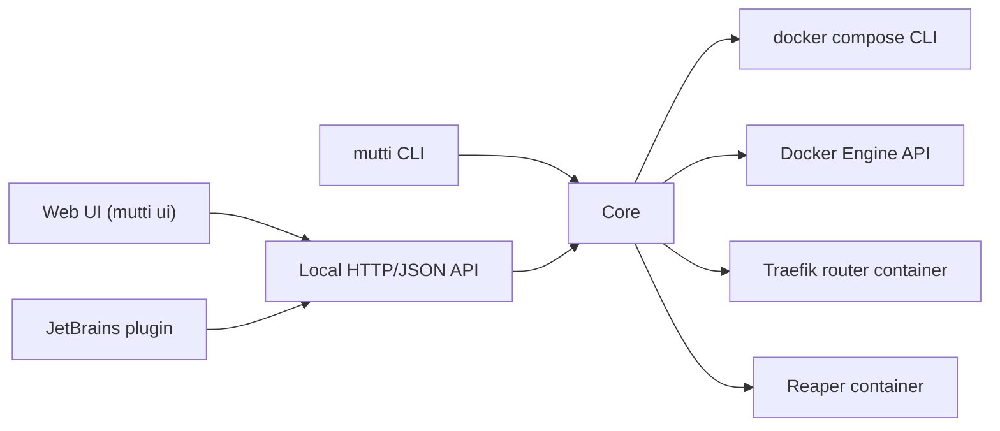

# mutti - parallel, isolated multi-service environments

> Spec for a Go CLI + local web UI + JetBrains plugin.
>
> Name: German "Mutti" (mom). She keeps track of all her kids (instances), knows where each one
> is (router) and cleans up after them (prune, reaper).

## 1. Problem

Teams run applications made of several equal services (APIs, frontends, workers) plus
infrastructure (databases, caches, mail catchers, mocks), described in Docker Compose.
They increasingly work on several branches at the same time: git worktrees, code review
checkouts, AI agents working in parallel.

Docker Compose alone gives one environment per project directory with no routing, no
lifecycle across copies and no safe throwaway runs. Existing tools cover only parts:

| Tool | Gap |
|------|-----|
| DDEV, Lando | One privileged "web" container on a tool-owned image; other services are second-class; no throwaway instances |
| Docktree, worktree-compose | Isolation via host ports; no real routing (HTTPS, path routing); no throwaway instances |
| Tilt, Garden, DevSpace, Skaffold | Require Kubernetes |
| Testcontainers | Throwaway instances only; no daily dev workflow, no routing |
| Dev Containers | One IDE environment; no parallel instances |

Teams end up writing thousands of lines of shell glue to close these gaps. `mutti` is that
glue as a maintained, generic tool.

## 2. Target users

- Teams with a multi-service app in Docker Compose (any language, any framework).
- Working on several branches/worktrees in parallel, humans and AI agents.
- Want the same environment definition locally, in tests and in CI.
- Do not want to run Kubernetes or a cloud service for development.

## 3. Principles

1. **Compose is the definition.** No new config language. Projects keep plain Compose files;
   `mutti` settings live in Compose `x-mutti` extension fields.
2. **All services are equal.** Routing, exec and debugging work the same for every service.
   Images always come from the project, never from a tool-owned base image.
3. **Docker is the state.** Instance state lives in container/volume/network labels. No
   database, no state file that can drift.
4. **Safe by default.** Two instances never share data. Throwaway instances are always
   cleaned up, also after a crash.
5. **Scriptable first.** Every command has `--json` output. The UI and the IDE plugin are
   clients of the same API.
6. **Platform-neutral.** Linux with Docker Engine is the reference. No Docker Desktop
   requirement. Works in any CI that offers Docker.

## 4. Concepts

| Term | Meaning |
|------|---------|
| **Project** | A repository with Compose files and an `x-mutti` section |
| **Instance** | One running, isolated copy of a project (one per worktree by default) |
| **Identity** | Unique instance name, derived from the worktree directory, stored once |
| **Ephemeral instance** | An instance created for one run (e.g. an E2E suite), always removed afterwards |
| **Router** | One machine-wide reverse proxy that routes `*.localhost` to instances |
| **Run ID** | Unique id per test run, used to name per-run resources (databases, caches) |

## 5. Requirements

### 5.1 Must

**Identity and isolation**
- M1: Any number of instances of the same project run in parallel on one host.
- M2: Instances share no volumes, networks, container names or host ports.
- M3: Identity is derived from the worktree directory name (sanitized to a DNS label),
  stored in a gitignored per-worktree file, and never recomputed on branch switch.
- M4: Identity collisions are detected and refused with a clear message: a second clone
  with the same directory name, or a name already owned by another existing path.
  Ownership is recorded as labels (`mutti.path`, `mutti.gitdir`).
- M5: A moved worktree (`git worktree move`) keeps its instance.

**Lifecycle**
- M6: `mutti up | down | stop | destroy` for the instance of the current directory.
- M7: `mutti list` across all projects on the machine: name, path, branch, status, URLs.
- M8: `mutti prune` removes instances whose worktree no longer exists. Dry run by default.
- M9: Bootstrap hooks per project (`x-mutti.hooks.bootstrap`, `post-up`, `pre-down`), run
  inside a named service.

**Routing**
- M10: One router per machine (Traefik) owns ports 80/443 on loopback.
- M11: Each instance gets `<instance>.localhost`; services get host routes
  (`api.<instance>.localhost`) and/or path routes (`/api` on the main host).
- M12: HTTPS with a locally generated CA; trusting it is an explicit opt-in command.
- M13: Only the router joins a shared network. Application containers stay in their
  instance network, so service DNS names never resolve across instances.

**Exec**
- M14: `mutti exec <service> -- <cmd>` targets the current directory's instance without
  naming it.
- M15: Files written by exec belong to the host user (UID/GID mapping, overridable per service).
- M16: Works nested: from inside a container (CI step, dev container) `mutti` reaches the
  host daemon and maps container paths back to host paths for bind mounts.

**Ephemeral instances**
- M17: `mutti run --ephemeral [--profile e2e] -- <cmd>` creates a fresh instance, waits for
  health checks, runs the command, removes the instance with its volumes, returns the
  command's exit code.
- M18: Cleanup is guaranteed after SIGINT/SIGTERM and after SIGKILL of `mutti`, via a reaper
  container (e.g. the Testcontainers `moby-ryuk` image) that removes resources by label when
  its connection drops.
- M19: Logs of all services are saved to an artifacts directory before teardown.

**Same definition everywhere**
- M20: Dev, test and CI use the same Compose files plus overlays (Compose profiles or extra
  files) declared in `x-mutti.overlays`.
- M21: Runs in CI on any runner with Docker access (socket or DinD); no TTY assumptions;
  `--json` and exit codes are stable.

### 5.2 Should

- S1: **Run IDs for parallel tests:** `mutti run-id` and env vars `MUTTI_INSTANCE`,
  `MUTTI_RUN_ID` injected into exec/run; `mutti sweep --older-than 24h` removes per-run
  resources by naming pattern (databases, cache dirs) via project hooks.
- S2: **Debugging per service:** `host.docker.internal` wired for every service, env
  conventions per debugger (Xdebug, Node inspector, delve, debugpy), and an
  `x-mutti.debug` block the IDE plugin reads to create path mappings.
- S3: **Dev container support:** `mutti devcontainer` generates or validates a
  `devcontainer.json` that attaches to a service of the current instance without starting
  bootstrap services.
- S4: **Resource hints:** `mutti list` shows memory per instance; warns above a threshold.
- S5: **Task runner adapters:** documented recipes and small shims for Nx, Turborepo, make,
  just, so tasks dispatch into the right instance and service.
- S6: **Hook adapters:** recipes for lefthook, husky, pre-commit.
- S7: **Test adapters:** Playwright `globalSetup` helper (npm package) that wraps
  `mutti run --ephemeral` style lifecycle.

### 5.3 Could

- C1: Shared infrastructure mode: one database server for all instances with one database
  per instance (saves memory; opt-in, per service).
- C2: Snapshots: save/restore an instance's volumes; restore from a sibling worktree.
- C3: Tunnel an instance to a public URL (cloudflared/ngrok) for demos.

## 6. Configuration sketch

```yaml
# compose.yml (project's own file, unchanged apart from x-mutti)
x-mutti:
  main: web                     # service behind <instance>.localhost
  routes:
    web:  { host: "",       port: 4200 }
    api:  { host: "api",    port: 80, path: /api }
    mail: { host: "mailpit", port: 8025 }
  exec:
    default-user: host          # map host UID/GID
  hooks:
    bootstrap:
      - service: api
        run: composer install && bin/console doctrine:migrations:migrate -n
  overlays:
    e2e: [compose.e2e.yml]
    ci:  [compose.ci.yml]
  debug:
    api: { type: xdebug, port: 9003, path-map: { "/var/www/html": "packages/api" } }

services:
  api: ...
```

`mutti` generates a throwaway override (labels, router network, removed host ports) next to
the user's files at runtime. The user's Compose files are never rewritten.

## 7. Architecture (Go)



- **Language:** Go, single static binary, Linux/macOS/Windows (WSL2) builds.
- **CLI:** `spf13/cobra`; every command supports `--json`.
- **Compose:** parse with `compose-spec/compose-go` (reads `x-mutti`, resolves profiles and
  files); execute via the `docker compose` CLI first (stable, matches user expectations).
  Embedding Compose as a library is a later option, not a v1 goal.
- **Docker:** official Engine API client for labels, listing, pruning, health checks.
- **Router:** Traefik container managed by `mutti`; dynamic config through the Docker
  provider (labels on each instance's ingress) or a generated file provider config.
- **Locking:** host-wide file lock for router start/replace and identity claims.
- **API:** `mutti serve` exposes a local HTTP/JSON API (localhost only, token in a
  user-only file) with an event stream (SSE) for status changes. CLI commands stay usable
  without it.
- **UI:** served by `mutti ui` (or the router at `http://localhost`): instance list,
  status, URLs, branch, logs, start/stop, prune. Go `embed` + server-rendered HTML with
  htmx, no build toolchain required.
- **Testing:** unit tests with a fake Docker client; integration tests against a real
  daemon in CI; a built-in `mutti doctor` that checks the environment.

## 8. JetBrains plugin

- **Target:** IntelliJ Platform, depends only on `com.intellij.modules.platform`, so it runs
  in PhpStorm, IntelliJ IDEA, WebStorm, GoLand, PyCharm, Rider. Language-specific features
  (Xdebug, Node debug) are optional dependencies loaded only when the language plugin exists.
- **Language:** Kotlin, Gradle IntelliJ Platform Plugin.
- **Talks to:** the local `mutti serve` API; falls back to `mutti ... --json` via CLI.
- **Features:**
  - Tool window: instances of the current project and all projects, status, branch, URLs.
  - Actions: up, down, destroy, prune, open URL, open logs, `exec` into a service terminal.
  - Status bar widget: current worktree's instance and health.
  - Run configurations: "mutti exec" and "mutti run --ephemeral" (e.g. for E2E suites).
  - Debug setup: reads `x-mutti.debug`, creates PHP servers / path mappings / Node attach
    configurations per service and instance.
- **Distribution:** JetBrains Marketplace, open source.

## 9. Non-goals

- Production deployment, Kubernetes, cluster management.
- A new environment description language or rewriting users' Compose files.
- Language- or framework-specific magic.
- Replacing CI systems or task runners; `mutti` is a building block inside them.

## 10. Milestones

1. **M0 identity:** identity claim + guards, `up/down/destroy/list/prune`, labels as state.
2. **M1 router:** machine-wide Traefik, host + path routes, HTTPS with local CA.
3. **M2 exec:** `exec` with UID mapping, nested mode, `--json` everywhere.
4. **M3 ephemeral:** `run --ephemeral` with reaper, log artifacts, run IDs and sweep.
5. **M4 UI:** `serve` API + web UI.
6. **M5 JetBrains plugin:** tool window, actions, run configurations, debug setup.
7. **M6 integrations:** dev container support, adapters for Nx/Turborepo/lefthook/Playwright.

## 11. Open questions

- Name conflicts (checked 2026-10-08): Homebrew, PyPI, crates.io, JetBrains Marketplace free;
  npm `mutti` taken (small, inactive since 2025-04), so a JS adapter needs a scoped name
  (e.g. `@mutti/playwright`); mutti.com is the Mutti tomato brand; mutti.dev and mutti.de taken;
  mutti.io / mutti.sh had no DNS record (registration not checked); GitHub not checked.
- `*.localhost` resolution outside browsers (curl/OS resolvers) on macOS and Windows; fallback
  to a resolver or `/etc/hosts` management.
- Rootless Docker and Podman support level.
- Path mapping in nested mode on macOS/Windows (Docker Desktop VM paths).
- License: MIT or Apache-2.0.
- Prior art to check in depth before starting: Docktree, worktree-compose, Port (jdtzmn/port),
  tug, Worktrunk hooks.
